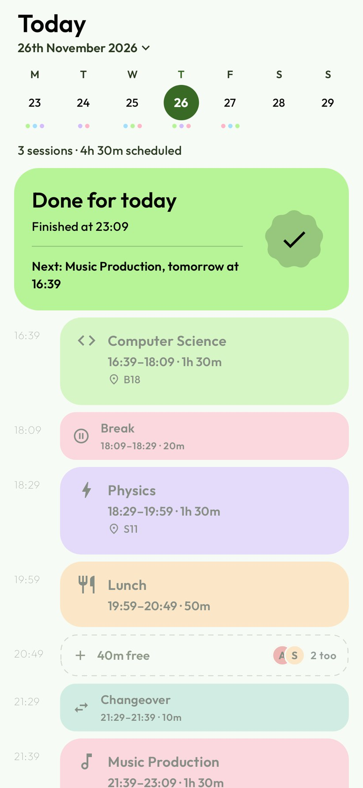
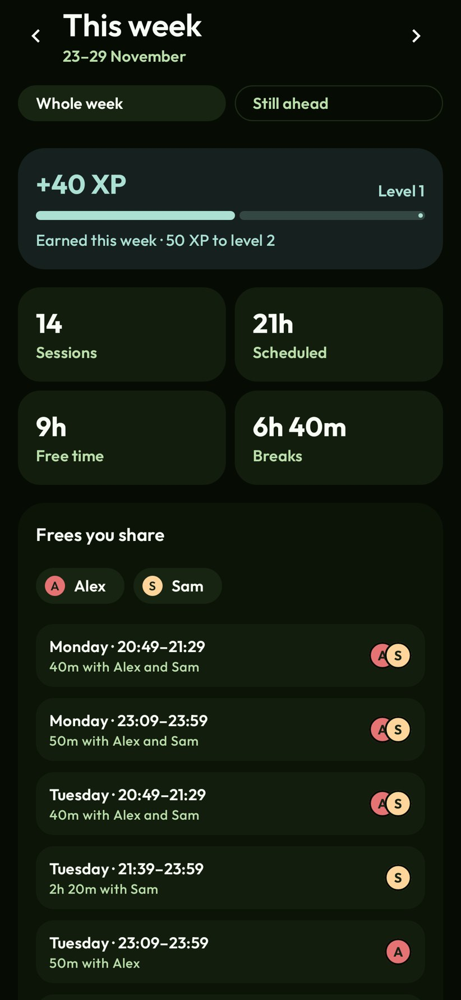
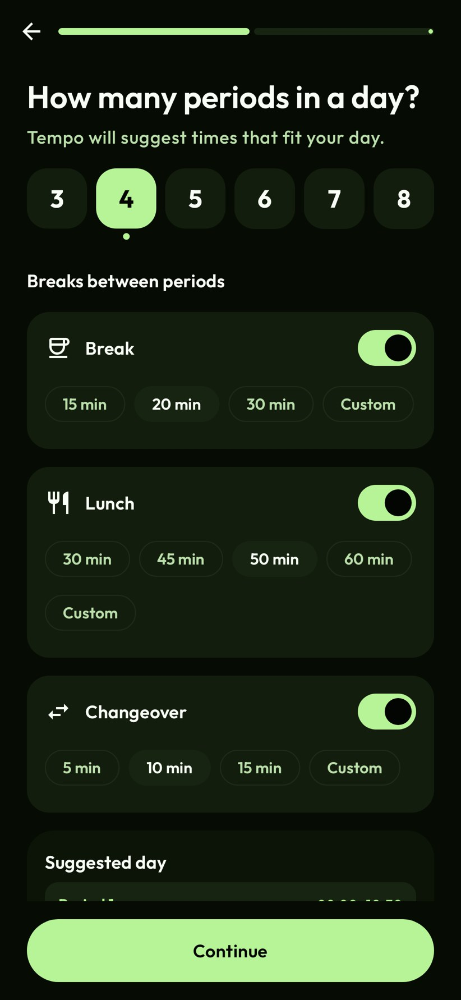
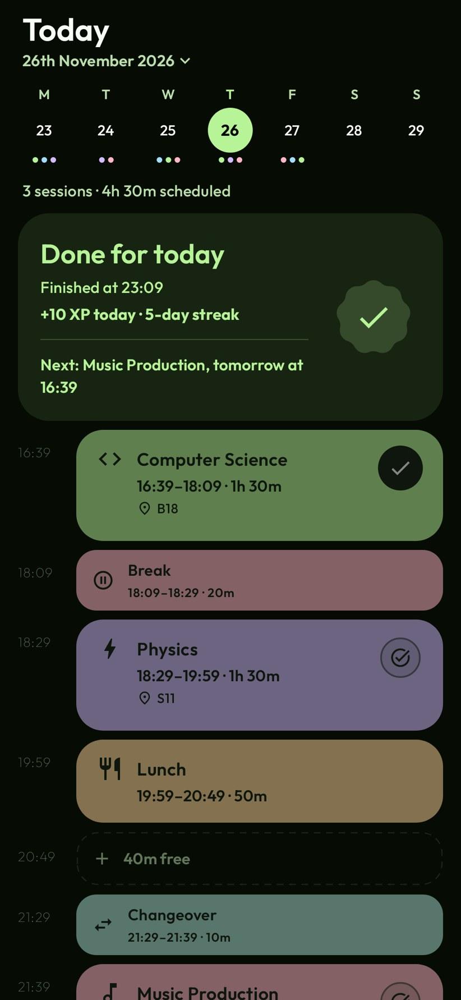
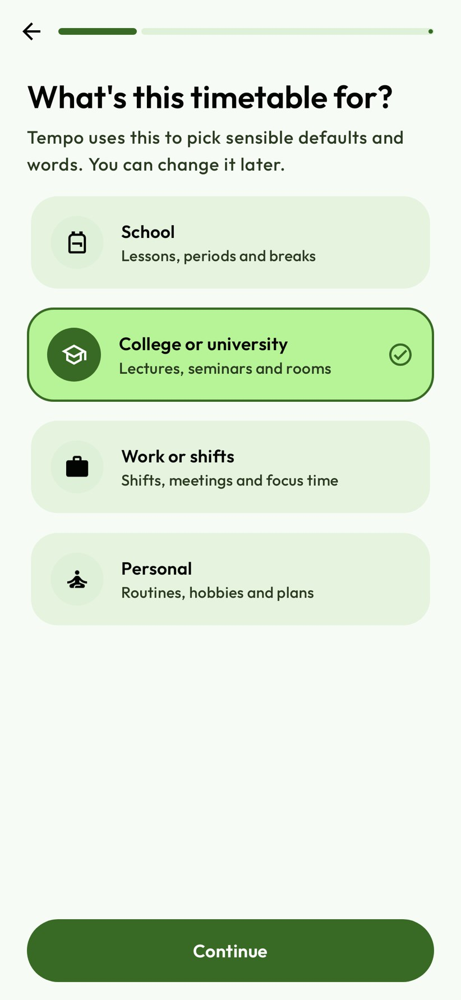
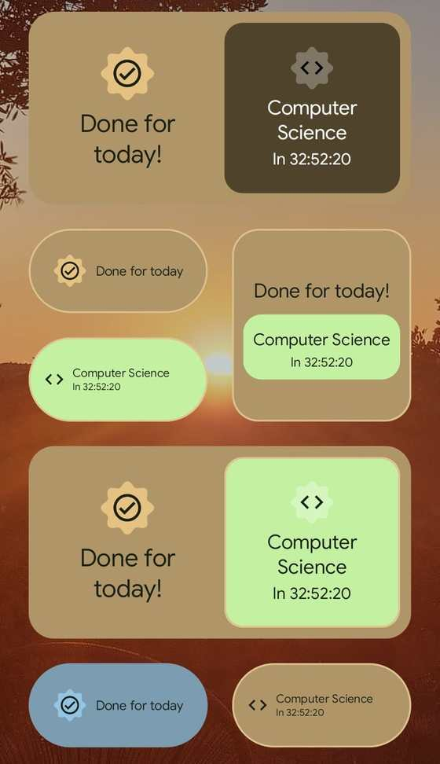

<p align="center">
  
</p>

<h1 align="center">Tempo</h1>

<p align="center"><em>Your week, in view.</em></p>

<p align="center">A flexible Material 3 Expressive timetable for school, college, work and everyday life.</p>

<p align="center"><strong>Made by XDan</strong></p>

## Get Tempo

Download the latest stable APK from [GitHub Releases](https://github.com/XDanfr/Tempo/releases). Tempo works on Android 8.0 (Oreo) and newer.

Tempo checks for new releases automatically and lets you know when one is ready. Tap Update to download it, and Android asks before installing. You can turn automatic checks off in Settings.

## Plan your week

- **See your day, live.** Schedule opens on today with a live countdown, a moving now-line and what's next. Swipe between days, or tap the date to jump anywhere.
- **Your week at a glance.** The Week tab shows every block on one grid, with totals for sessions, scheduled time, free time and breaks, and a breakdown by subject. Switch between the whole week and what's still ahead.
- **Find frees with friends.** Add your name, mark a friend's imported timetable as theirs, and Tempo shows when you're both free, on your day and across the week. It all stays on your device.
- **Set up in a minute.** Tell Tempo what the timetable is for and it suggests your days, hours, periods and breaks, with one-tap subject suggestions.
- **Make schedules that fit your life.** Keep separate timetables for school, college, work or personal activities, with alternating weeks (up to 52), holidays and one-off changes.
- **Edit without worry.** Every change can be undone straight from the snackbar. Duplicate or split sessions, and edit selected recurring sessions together.
- **Celebrate, if you want to.** Confetti when your day's done. Turn on check-ins to earn XP and keep a gentle streak that weekends and holidays never break. It's optional and off whenever you like.
- **Make it yours.** Twelve subject colours, icons, rooms, and Forest, Ocean, Amber, Red, Violet, Rose or wallpaper-based Material You themes in light, dark or system mode.
- **Keep your schedule close.** An adaptive home-screen widget shows what's now and next, from a compact countdown to a mini agenda.
- **Back up and share files.** Export a `.tempo.json` backup, or share a day or week as an image.

## See Tempo in action

<p align="center">
  
  &nbsp;
  
  &nbsp;
  
</p>

<p align="center"><em>Your day live, your week at a glance, and setup that suggests the details for you.</em></p>

<details>
  <summary>More screenshots</summary>

  <p align="center">
    
    &nbsp;
    
  </p>
</details>

## Widgets at a glance

<p align="center"></p>

## Updates and privacy

Your timetables, check-ins and friends' timetables stay on your device unless you export them. Tempo has no accounts or analytics. Update checks contact GitHub; they do not send your timetable. Manual import and export use Android’s file picker.

## What’s next

Encrypted share links that keep friends' timetables up to date, groups for finding shared frees, achievements, calendar `.ics` integration and optional homework tracking are planned. See the [roadmap](docs/ROADMAP.md) for details.

## Support Tempo

[Report a bug or suggest a feature](https://github.com/XDanfr/Tempo/issues) · [Sponsor XDan](https://github.com/sponsors/XDanfr) · [xdan.cc](https://xdan.cc)

<details>
  <summary>For contributors</summary>

Open the project in Android Studio with JDK 17 and Android SDK 37.1 (build-tools 36.0.0). The Widget 2.0 branch uses AGP 9.2.1 / Gradle 9.4.1 and Glance 1.3.0-alpha02; Android 8+ and target SDK 36 are retained. The Gradle wrapper is included:

```sh
./gradlew :core:model:test :core:schedule:test :core:data:testDebugUnitTest :app:testDebugUnitTest :app:lintDebug :app:assembleDebug
# With an Android emulator or test device connected:
./gradlew :app:connectedDebugAndroidTest
```

Release builds use R8 minification and resource shrinking. See [architecture](docs/ARCHITECTURE.md) for module boundaries. Outfit is bundled under the SIL Open Font Licence; its licence is included with the font assets.

</details>
